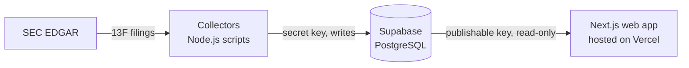

# Stock Positioning Tracker

A research platform for U.S.-listed stocks that tracks institutional ownership from SEC Form 13F
filings, with short-interest tracking planned. It analyzes portfolio holdings, ownership changes and
historical positions to show how institutions and the wider market are positioned.

**Live site:** https://stock-positioning-tracker.vercel.app

## Objectives

- Five years of quarterly 13F holdings for about 20 institutional investors.
- Short-interest history for a watchlist of about 40–50 stocks.
- Historical comparisons, charts and research dashboards per investor and per stock.
- Automated, scheduled data collection.

## Architecture

| Part | Technology | Location |
| --- | --- | --- |
| Web app | Next.js 16, React 19, TypeScript; data is loaded on the server | [src/](src/) |
| Database | Supabase (PostgreSQL): tables, research views, row-level security, validation triggers | [supabase/](supabase/) |
| Collectors | Node.js scripts run locally with npm | [collectors/](collectors/) |
| Hosting | Vercel, deployed from this GitHub repository | — |

The database is the single source of truth. Collectors are the only writers and use a server-side
secret key. The web app uses the read-only publishable key, and only on the server, so no database
key reaches the browser. Public readers see only fully validated filings.

## What works today

**Database** ([details](supabase/README.md))

- Nine tables: investors, their CIKs, securities, security identifiers, conversion ratios from
  corporate actions, filings, holdings, short interest and collection runs. Plus research views that turn raw filings into quarterly
  portfolios and positions.
- The database itself verifies each filing's row count and value total (within rounding) against
  the SEC summary before accepting it. Completed filings cannot be changed.
- Amendments are applied automatically: a restatement replaces a report, and a new-holdings
  amendment adds to it. Replaced filings stay stored as history.

**SEC 13F collector** ([details](collectors/README.md))

- Imports the latest quarter, chosen quarters or a quarter range for any investor.
- Finds and imports amendments, including ones filed months later.
- Is safe to re-run: filings are matched by accession number and never imported twice.
- Reads every stored row back and compares it field by field with the SEC filing.
- Supports investors that filed under several CIKs, e.g. after a corporate reorganization.

**Stock identification** (`npm run add:security`, [details](collectors/README.md#stocks))

- Adds a stock (one share class) with its CUSIP and ticker after OpenFIGI, SEC's company ticker
  file, Nasdaq's directory of US-listed securities (which gives the listing exchange) and our filings
  agree, one at a time or all the stocks an investor reported (optionally only
  its largest positions). Holdings are matched to stocks by CUSIP when a page is read.

**Web app**

- Two research sections, Investors and Stocks, linked from the homepage and the main navigation.
- Investors page: every investor in the database with its latest quarter, reported value and
  history.
- Investor dashboards: one shared page, `/investors/[slug]`, for every investor in the database
  (e.g. `/investors/berkshire-hathaway`, `/investors/blackrock`). Each investor's URL name is stored
  in the database when it is added, so it stays the same if the investor's name changes. Portfolio value by quarter (chart
  and table), quarter selection, largest holdings, and the SEC filings behind each quarter with
  links to EDGAR. Positions are combined in the database, so large filers load quickly.
- Stocks page: the stocks that can be matched to holdings, with search by ticker, company name or
  CUSIP.
- Stock pages, `/stocks/[ticker]` (e.g. `/stocks/AAPL`): which tracked investors report holding the
  stock in a quarter, their shares, values and change from the previous quarter (increased,
  decreased, unchanged, new or closed), and a chart of one investor's reported shares by quarter.
  A reported zero is shown differently from a quarter with no report, and from an unclear quarter
  (shares under the stock's CUSIP outside its recorded dates). A change by an exact whole-number
  ratio is labelled as a likely stock split rather than as buying or selling, a split recorded from
  the company's announcement is labelled as a stock split, and shares received in a recorded
  corporate action (a merger or reclassification) are labelled as received. Holdings in
  dashboards link to stock pages, and stock pages link back to the dashboards.

**Data checks and backups**

- `npm run check:data` lists what needs review after an import: missing quarters, mistyped CUSIPs,
  values that disagree between investors or jump between quarters, and stocks whose ticker or
  CUSIP has changed ([details](collectors/README.md#checking-the-data)).
- `npm run backup:db` saves every row and proves the backup restores exactly
  ([details](supabase/README.md#backups)).

## Current data

As of 29 October 2026, every investor has 20 quarters, Q3 2021 – Q2 2026, except as noted.
Positions combine an investor's rows for the same security.

| Investor | CIKs | Quarters | Filings | Q2 2026 |
| --- | --- | --- | --- | --- |
| Appaloosa | 1656456 | 20 | 20 | 27 positions, $7.73B |
| Baker Bros. Advisors | 1263508 | 20 | 20 | 84 positions, $19.96B |
| Baupost Group | 1061768 | 20 | 20 | 23 positions, $5.42B |
| Berkshire Hathaway | 1067983 | 20 | 24 | 29 positions, $299.25B |
| BlackRock | 2012383 (since Q3 2024), 1364742 (until Q2 2024) | Q2 2026 only | 1 | 5,696 positions, $6.73T |
| Bridgewater Associates | 1350694 | 20 | 20 | 997 positions, $24.38B |
| Coatue Management | 1135730 | 20 | 21 | 66 positions, $48.63B |
| D. E. Shaw | 1009207 | 20 | 22 | 4,833 positions, $210.20B |
| Elliott Investment Management | 1791786 | 20 | 23 | 29 positions, $22.67B |
| Greenlight Capital | 1079114, 1489933 (DME Capital Management) | 20 | 20 | 46 positions, $3.91B |
| Lone Pine Capital | 1061165 | 20 | 20 | 34 positions, $16.36B |
| Pershing Square | 1336528, 2026053 (Pershing Square Inc., from Q2 2026) | 20 | 22 | 14 positions, $19.47B |
| Renaissance Technologies | 1037389 | 20 | 20 | 3,140 positions, $72.62B |
| State Street | 93751 | 19 (no Q1 2023) | 20 | 4,261 positions, $3.38T |
| TCI Fund Management | 1647251 | 20 | 20 | 11 positions, $52.77B |
| Third Point | 1040273 | 20 | 20 | 43 positions, $4.68B |
| Tiger Global Management | 1167483 | 20 | 20 | 46 positions, $23.98B |
| Two Sigma Investments | 1179392 | 20 | 20 | 5,017 positions, $138.12B |
| ValueAct Holdings | 1418814 | 19 (no Q3 2024) | 19 | 18 positions, $5.63B |
| Viking Global Investors | 1103804 | 20 | 22 | 90 positions, $35.08B |

Two quarters are left out on purpose: State Street's Q1 2023 summary page drops a digit from its
total, so the filing cannot be checked, and ValueAct's Q3 2024 amendment is labelled as new holdings
but repeats the whole report, so importing it would double count.

Database totals: 20 investors, 394 filings, 430,587 holding rows, 145 MB. 4,621 stocks are
identified: BlackRock's 500 largest positions and every listed stock the other investors reported,
except ETFs, funds, warrants, units and CUSIPs that need a person (see
[collectors/README.md](collectors/README.md#stocks)), with 37 official conversion ratios from
corporate actions, 30 of them stock splits. No short-interest data yet.

## Unfinished features

- **Short-interest collector.** The database tables and views exist; nothing fills them yet.
- **BlackRock history.** BlackRock has one quarter; its earlier quarters are not imported (see
  Storage below).
- **More stocks.** Delisted stocks and stocks whose CUSIP changed (such as Exxon Mobil's) have no
  stock page yet; see `npm run add:security`. Renamed companies whose filers used the old name
  (such as Anthem, now Elevance Health) show older quarters as "unclear" until a person confirms the
  rename. Stock prices and short interest are not shown yet.
- **Automation.** Collection runs manually, one investor at a time. There is no investor list
  and no scheduled job (GitHub Actions is planned).

## Known limitations

- **Storage.** The database uses 145 MB of the free plan's 500 MB. BlackRock reports about 50,000
  rows per quarter, so five years would be about one million rows. Measure Supabase storage before
  importing more large filers.
- **Unsupported filings.** 13F-NT notices, amendments for a quarter with no original report, and
  pre-2013 text-format filings.
- **13F data itself.** 13F is a quarter-end snapshot filed up to 45 days later. It covers only
  long positions in SEC-listed securities, so it excludes short positions and cash. A change in
  shares is a reported change, not proof of a trade.
- **Not point-in-time.** The research views show the latest validated history, so they are not
  suitable for backtesting as of a past date.
- **Stock splits and reorganizations.** Share counts are shown as reported, not adjusted for
  splits. A split recorded from the company's announcement is labelled "Stock split", with any
  trading that quarter shown separately; splits that changed the CUSIP (Lam Research, Super Micro
  Computer, Arista Networks in 2024) are not recorded yet. An unrecorded split is labelled as likely
  only when the investor did not also trade that quarter, and for 2- and
  3-for-1 only when the price moved little, since round-number trades can look the same. A reverse
  split is labelled only when another tracked investor's holding changed by the same ratio. An earlier
  CUSIP is linked to a stock only when it was converted one-for-one. Shares received at another ratio
  (such as in Sirius XM's September 2024 merger) are labelled as received only when that conversion's
  ratio is recorded, and are estimated from the holdings reported for the quarter before.
- **Availability.** Supabase's free plan pauses a project after a period without activity, which
  takes the live site offline until it is restored from the Supabase dashboard.

## Run locally

1. Install dependencies: `npm install`
2. Copy `.env.example` to `.env.local` and set `SUPABASE_URL` and `SUPABASE_PUBLISHABLE_KEY`.
   The web app needs only the publishable key, which can read research data but not write it.
   Collectors also need `SEC_USER_AGENT` and `SUPABASE_SECRET_KEY` (see
   [collectors/README.md](collectors/README.md)).
3. Start the app with `npm run dev` and open http://localhost:3000.

On Vercel, set `SUPABASE_URL` and `SUPABASE_PUBLISHABLE_KEY` only; the secret key never belongs in
the web app.

Checks (offline; they never touch Supabase or SEC): `npm run test:db`, `npm run test:collectors`,
`npm run test:web`, `npm run typecheck` and `npm run lint`. Read-only checks of the live data:
`npm run check:data`; backups: `npm run backup:db`.

## Further documentation

- [collectors/README.md](collectors/README.md): collector commands, amendments, multiple CIKs.
- [supabase/README.md](supabase/README.md): schema, research views, access rules, applying migrations.
- [AGENTS.md](AGENTS.md): rules for AI coding agents working on this repository.
