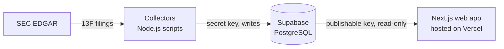

# Stock Positioning Tracker

A research platform for U.S.-listed stocks that tracks institutional ownership from SEC Form 13F
filings, with short-interest tracking planned. It analyzes portfolio holdings, ownership changes and
historical positions to show how institutions and the wider market are positioned.

**Live site:** https://stock-positioning-tracker.vercel.app

## Objectives

- Five years of quarterly 13F holdings for about 20 institutional investors.
- Short-interest history for a watchlist of about 40–50 stocks.
- Historical comparisons, charts and research dashboards per investor and per stock.
- Automated, scheduled data collection.

## Architecture

| Part | Technology | Location |
| --- | --- | --- |
| Web app | Next.js 16, React 19, TypeScript; data is loaded on the server | [src/](src/) |
| Database | Supabase (PostgreSQL): tables, research views, row-level security, validation triggers | [supabase/](supabase/) |
| Collectors | Node.js scripts run locally with npm | [collectors/](collectors/) |
| Hosting | Vercel, deployed from this GitHub repository | — |

The database is the single source of truth. Collectors are the only writers and use a server-side
secret key. The web app uses the read-only publishable key, and only on the server, so no database
key reaches the browser. Public readers see only fully validated filings.

## What works today

**Database** ([details](supabase/README.md))

- Eight tables: investors, their CIKs, securities, security identifiers, filings, holdings, short
  interest and collection runs. Plus four research views that turn raw filings into quarterly
  portfolios.
- The database itself verifies each filing's row count and value total against the SEC summary
  before accepting it. Completed filings cannot be changed.
- Amendments are applied automatically: a restatement replaces a report, and a new-holdings
  amendment adds to it. Replaced filings stay stored as history.

**SEC 13F collector** ([details](collectors/README.md))

- Imports the latest quarter, chosen quarters or a quarter range for any investor.
- Finds and imports amendments, including ones filed months later.
- Is safe to re-run: filings are matched by accession number and never imported twice.
- Reads every stored row back and compares it field by field with the SEC filing.
- Supports investors that filed under several CIKs, e.g. after a corporate reorganization.

**Web app**

- Two research sections, Investors and Stocks, linked from the homepage and the main navigation.
- Investors page: every investor in the database with its latest quarter, reported value and
  history.
- Berkshire Hathaway dashboard: portfolio value by quarter (chart and table), quarter selection,
  largest holdings, and the SEC filings behind each quarter with links to EDGAR.
- Stocks page: a placeholder describing the planned Stock Analysis section.

## Current data

As of 28 October 2026:

| Investor | CIKs | Quarters | Filings | Latest quarter |
| --- | --- | --- | --- | --- |
| Berkshire Hathaway Inc | 1067983 | 20 quarters, Q3 2021 – Q2 2026 | 24 (3 quarters amended) | Q2 2026: 89 rows, $299.25B |
| BlackRock, Inc. | 2012383 (since Q3 2024), 1364742 (BlackRock Inc. until Q2 2024) | Q2 2026 only | 1 | Q2 2026: 49,968 rows, $6.73T |

Database totals: 2 investors, 25 filings, 52,828 holding rows. No short-interest or
security-mapping data yet.

## Unfinished features

- **Short-interest collector.** The database tables and views exist; nothing fills them yet.
- **Remaining investors.** Only Berkshire Hathaway has full history. BlackRock has one quarter,
  and the other ~18 investors have not been imported.
- **Stock Analysis.** Holdings keep the CUSIP reported in each filing. They are not yet mapped
  to securities and tickers, so the Stocks section is a placeholder.
- **Investor dashboards beyond Berkshire.** The Investors page lists every investor, but only
  Berkshire Hathaway has a dashboard; BlackRock's holdings are stored but not shown.
- **Automation.** Collection runs manually, one investor at a time. There is no investor list
  and no scheduled job (GitHub Actions is planned).

## Known limitations

- **Storage.** BlackRock reports about 50,000 rows per quarter (95% of the current data), so five
  years would be about one million rows. Measure Supabase storage before importing more large
  filers.
- **Unsupported filings.** 13F-NT notices, amendments for a quarter with no original report, and
  pre-2013 text-format filings.
- **13F data itself.** 13F is a quarter-end snapshot filed up to 45 days later. It covers only
  long positions in SEC-listed securities, so it excludes short positions and cash. A change in
  shares is a reported change, not proof of a trade.
- **Not point-in-time.** The research views show the latest validated history, so they are not
  suitable for backtesting as of a past date.

## Run locally

1. Install dependencies: `npm install`
2. Copy `.env.example` to `.env.local` and set `SUPABASE_URL` and `SUPABASE_PUBLISHABLE_KEY`.
   The web app needs only the publishable key, which can read research data but not write it.
   Collectors also need `SEC_USER_AGENT` and `SUPABASE_SECRET_KEY` (see
   [collectors/README.md](collectors/README.md)).
3. Start the app with `npm run dev` and open http://localhost:3000.

On Vercel, set `SUPABASE_URL` and `SUPABASE_PUBLISHABLE_KEY` only; the secret key never belongs in
the web app.

Checks (offline; they never touch Supabase or SEC): `npm run test:db`, `npm run test:collectors`,
`npm run test:web`, `npm run typecheck` and `npm run lint`.

## Further documentation

- [collectors/README.md](collectors/README.md): collector commands, amendments, multiple CIKs.
- [supabase/README.md](supabase/README.md): schema, research views, access rules, applying migrations.
- [AGENTS.md](AGENTS.md): rules for AI coding agents working on this repository.
