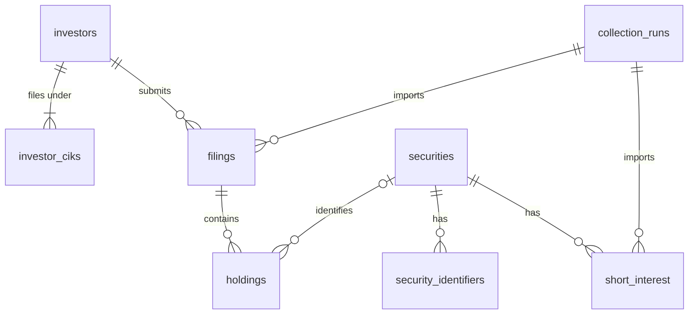

# Research database

The migrations create eight tables and five read-only research views.
They require PostgreSQL 15 or newer and the standard Supabase `anon`,
`authenticated`, and `service_role` roles. Authentication UI is not required.

## Tables

| Table | Purpose |
| --- | --- |
| `investors` | Tracked filing managers, identified by zero-padded 10-digit CIKs, with a permanent URL `slug` assigned when each is added. |
| `investor_ciks` | Every CIK an investor has filed under, e.g. before and after a reorganization; each CIK belongs to one investor. |
| `securities` | Stable internal identities for security/share classes and the short-interest watchlist flag. |
| `security_identifiers` | Verified CUSIP, ticker, FIGI and provider-symbol mappings with validity periods. |
| `filings` | SEC filing metadata, amendment links, source evidence, summary totals and validation state. |
| `holdings` | Every source row, including unmapped securities and separate option positions. |
| `short_interest` | Dated observations and their correction history, separated by provider. |
| `collection_runs` | Private run status, checkpoints, counts and sanitized error messages. |



## Importing SEC filings

1. Create a `collection_runs` row with `collector = 'sec13f'`.
2. Insert each filing as `pending`, using its unique SEC accession number.
3. Insert all information-table rows. `source_row` is the stable 1-based row
   number in the original file, not a security identifier. Keep original rows,
   identifiers and units; leave `security_id` null if matching is uncertain.
4. Set the filing to `complete`. A trigger verifies the imported row count and
  source-value sum against the filing summary, including contiguous row numbers. The transition fails on a
   mismatch, and incomplete filings/holdings remain hidden from public readers.
5. Finish the run with `status` and `finished_at`. Run success and filing
   validation are separate: one run may partially succeed.

`reported_value` and `reported_total_value` preserve the source unit.
Set `value_multiplier` to `1000` for thousands or `1` for dollars, based on the
filing format. Research views expose normalized `value_usd` amounts. Do not
infer units from the reporting quarter alone: an old quarter can be amended
under a newer filing format. Exact decimal numbers are used for quantities
and money; unavailable values remain null rather than becoming zero.

Keep `source_url` and, when available, a SHA-256 `source_checksum` and an
archived `source_document_reference`. Large original files can be archived in
private object storage later; this migration does not create storage buckets.

Each holding's typed columns hold its information-table fields. `raw_row` keeps
only what those columns cannot reproduce exactly: fields the collector does not
read (such as `figi`) and values in a non-standard format. The SEC row is the
columns' fields plus `raw_row`, so `raw_row` is usually `{}`; see
`collectors/sec13f/source-row.mts`. Store only source data in `raw_row`, never
request credentials or signed URLs.

Completed filings and their source rows are immutable. Updating a holding's
`security_id` is allowed so unresolved identifiers can be matched later.
Amendments are new filings linked to the original filing for that investor and
quarter; unresolved links must be resolved before marking an amendment complete.

## Research views and comparisons

- `portfolio_filings`: chooses the latest validated original/restatement for
  each investor and quarter, then includes later additions linked to that same
  original. Source order is filing timestamp, amendment number, accession.
- `portfolio_holdings`: the selected source rows, with normalized USD values.
- `portfolio_positions`: `portfolio_holdings` rows for the same security (CUSIP), position type
  and quantity type combined into one position, as dashboards show them. Pages read only the
  positions they display instead of every source row.
- `quarterly_portfolios`: row counts, total reported value and coverage flags.
  A validated zero-row report appears here; a missing report does not.
- `latest_short_interest`: latest accepted revision per security, settlement
  date and provider, retaining earlier accepted versions in the base table.

For comparisons, join on investor, reporting periods and security identity,
keeping share class, quantity type and long/put/call positions separate.
Retain unmapped rows in totals and report incomplete mapping coverage.
Distinguish a missing quarter from a reported exit; use `quarterly_portfolios`
to check that both periods exist before calculating changes.

13F notices do not represent empty portfolios and are excluded from portfolio
views. Combination reports and confidential omissions are flagged; the
collector must follow other-manager references before claiming complete
manager coverage. Do not sum overlapping parent/subsidiary reports as unique
market ownership. A share-count change is a reported change, not proof of a
trade; corporate actions require separate handling before trade attribution.

These views show the latest validated history. They are not point-in-time
backtesting views: historical simulations must separately limit filings and
revisions to information available at the simulated date.

## Short-interest revisions

Each collector can create/reuse securities without waiting for the other.
The watchlist flag controls future collection, not retention or public reads.

Create a `short_interest` run with a stable provider slug. Insert observations
as `pending`, preserving settlement date, publication/revision timestamps and
source references when available. Missing publication times remain null.
After provider validation, set `validation_status = 'accepted'` or `rejected`.

The database assigns revision numbers under a per-series transaction lock.
An unchanged repeat of the most recent observation returns no inserted row.
Changed data creates another revision. A legitimate A-to-B-to-A correction is
retained. Changes to retrieval time, run ID or archive reference alone do not
create revisions; `raw_record` must exclude transient request metadata.

Validated observations cannot be edited or deleted. A pending observation can
change validation status, but changing data requires inserting a new revision.
The database rejects acceptance of a known older provider revision timestamp.
Collectors must establish the provider's revision order before accepting data;
an older archived response must not supersede a newer correction merely because
it was fetched later. Different providers are never automatically merged.

Float and volume dates/windows are stored where available. Reported short
percentage and days-to-cover fields retain provider definitions. Do not derive
ratios from a denominator with an unknown or mismatched date. Short percentage
can exceed 100; daily short-sale volume is a different dataset.

## Identifier matching

Ticker namespaces use exchange MICs (for example `XNAS`); provider symbols use
the provider's slug. CUSIPs and FIGIs have an empty namespace. Use consistent
case from the source identifier system. Validity starts are inclusive and ends
exclusive. Overlapping periods for the same scoped identifier are rejected,
including concurrent inserts. Dates must be evidenced; never invent historical
coverage to make a match. Keep uncertain identifiers on the original holding
until a verified mapping is available.

The website matches holdings to a stock when a page is read: rows whose
`reported_cusip` is one of the stock's CUSIP identifiers, for quarters inside that
identifier's validity. `holdings.security_id` is not filled in, so nothing has to be
re-mapped after an import or a corrected identifier. An index on
`holdings.reported_cusip` keeps these lookups direct.

Holdings under one of a stock's CUSIPs in a quarter outside every validity period
of that CUSIP are not counted as the stock; stock pages show the quarter as
"unclear" instead of as a zero. A CUSIP that filers mistyped, or an earlier CUSIP
replaced one-for-one in a corporate action, is recorded as a further CUSIP
identifier of the stock, valid only for the period it identified the stock (see
[collectors/README.md](../collectors/README.md#mistyped-cusips-earlier-cusips-and-start-dates)).

## Backups

```sh
npm run backup:db -- --label before-some-change
```

Reads every row of the eight tables through the Supabase CLI (it must be logged in
and linked to this project; the command refuses to run if the linked project is
not the one in `SUPABASE_URL`) and saves them, with the list of applied
migrations, to `~/Backups/stock-positioning-tracker/<date>-<time>-<label>/`. It
then restores the backup into a local in-memory database built from the
migrations and checks that every table matches the live database exactly. Make a
backup before every approved write.

## Access

RLS is enabled on all eight tables. `anon` and `authenticated` can only read
reference data (including investor CIKs), completed filings/holdings and accepted
short-interest records.
The views run with the caller's permissions. Public roles have no write grants,
access to collection logs, sequence privileges or helper-function execution.
Collectors use server-side `service_role` access; never expose that credential
to the browser. No credentials or real investor data are included in these files.

## Validation and applying the migration

Run `npm run test:db`. The tests create an isolated, disposable PostgreSQL engine
using PGlite and simulate Supabase roles, including permissive default grants.
No cloud project, API key or Docker installation is needed. Test fixtures never
reach Supabase. The test dependency is development-only.

Apply migrations using an authenticated Supabase CLI, specifying the intended
project ref explicitly:

```sh
npx supabase db push --project-ref YOUR_PROJECT_REF --dry-run --skip-vault
npx supabase db push --project-ref YOUR_PROJECT_REF --skip-vault
```

The CLI records applied migrations in Supabase's migration history, so subsequent
pushes skip them. The initial script is transactional and deliberately fails if
its tables already exist without a migration record. Inspect the target project
first; do not run a database reset. No project credentials are stored in this repo.

The initial schema adds no sample rows, collectors, login flow or application
database connection. Five-year storage usage should be measured with actual
portfolios before committing to a free-tier capacity assumption.

References: [SEC 13F FAQ](https://www.sec.gov/rules-regulations/staff-guidance/frequently-asked-questions-about-form-13f),
[FINRA short interest](https://www.finra.org/investors/insights/short-interest),
[Supabase RLS](https://supabase.com/docs/guides/database/postgres/row-level-security).
